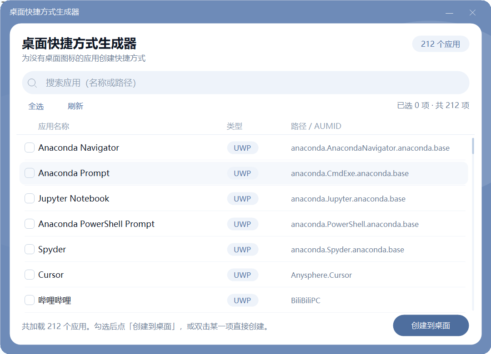

# 桌面快捷方式生成器 (AppShortcutCreator)

一键为「桌面上没有图标的应用」在桌面创建快捷方式，等价于手动流程：

> **Win+R → 输入 `shell:AppsFolder` → 找到应用 → 右键「创建快捷方式」→ 弹窗确认放到桌面**

单文件、零第三方依赖，仅使用 Windows 系统自带组件。特别适合给 Microsoft Store / UWP 应用（计算器、截图工具、哔哩哔哩等）快速创建桌面图标。

## 直接下载

不想编译？前往 [Releases](../../releases/latest) 下载 `AppShortcutCreator.exe`，双击即可运行（无需安装、无需 .NET 运行时下载，使用系统自带 .NET Framework 4.x）。

> 首次运行若被 SmartScreen 提示，点击「更多信息」→「仍要运行」即可。这是未签名开源程序的正常提示。

## 功能特性

- **枚举全部应用**：读取 `shell:AppsFolder`，与开始菜单「所有应用」一致，含 UWP/商店应用与传统桌面应用
- **一键创建**：搜索 → 勾选（或双击）→ 点击创建，自动写入桌面
- **UWP 原生支持**：与系统右键「创建快捷方式」产物完全一致，双击可启动、图标自动继承
- **搜索过滤**：按名称或路径实时过滤，应用多也不难找
- **命令行模式**：`--list` / `--create`，方便脚本化批量处理
- **中英文应用名通吃**，文件名非法字符自动清理

## 截图

<!-- 欢迎 PR 补充截图：双击 exe → 搜索框输入关键词 → 截图放至 docs/screenshot.png → 取消下一行注释 -->
<!--  -->

## 快速开始

**方式一：直接下载（推荐普通用户）**

从 [Releases](../../releases/latest) 下载 exe，双击运行。

**方式二：从源码编译（推荐开发者）**

```bat
git clone https://github.com/<your-name>/desktop-shortcut-creator.git
cd desktop-shortcut-creator
build.bat
```

`build.bat` 会自动调用系统自带的 csc.exe 编译，无需安装 Visual Studio 或 .NET SDK。脚本优先使用 64 位编译器（`Framework64\v4.0.30319`），不存在时回退 32 位。

编译命令明细：

```bat
%WINDIR%\Microsoft.NET\Framework64\v4.0.30319\csc.exe /nologo /target:winexe ^
  /platform:anycpu /codepage:65001 /optimize+ /out:AppShortcutCreator.exe ^
  /r:System.dll /r:System.Core.dll /r:System.Drawing.dll ^
  /r:System.Windows.Forms.dll /r:Microsoft.CSharp.dll AppShortcutCreator.cs
```

> `/codepage:65001` 必须保留：源码为 UTF-8 编码，缺少该参数时中文字符串可能被按 ANSI 读取导致界面乱码。

## 使用说明

### GUI 模式（默认）

双击 `AppShortcutCreator.exe`（不带参数），窗口标题为「桌面快捷方式生成器」：

1. **搜索框**：顶部输入关键字即时过滤列表（匹配应用名称或路径/AUMID）。
2. **应用列表**：三列（应用名称 / 类型 / 路径或 AUMID），每行带复选框。
   - 类型为「UWP 应用」：商店/系统应用，路径列显示 AUMID（如 `Microsoft.WindowsCalculator_8wekyb3d8bbwe!App`）
   - 类型为「桌面应用」：传统 Win32 程序，路径列显示 exe 全路径
   - 类型为「暂不支持」：系统未提供路径信息的特殊项，无法创建
3. **全选 / 取消全选**：按钮自动在两种状态间切换。
4. **创建到桌面**：为所有勾选项创建桌面快捷方式；状态栏逐条显示结果（成功 / 已存在被覆盖 / 失败原因），并汇总「成功 N 个」。
5. **双击列表某一项**：跳过勾选，直接为该项创建快捷方式。

快捷方式保存在 `Environment.GetFolderPath(DesktopDirectory)` 对应的桌面（兼容 OneDrive 重定向），文件名为「应用名.lnk」（已自动去掉非法文件名字符）；同名文件会被覆盖。

### CLI 模式（便于自动化）

> 本程序编译为 winexe，已内置控制台附着逻辑（`AttachConsole(ATTACH_PARENT_PROCESS)`），在 cmd / PowerShell 中直接运行即可看到输出；输出被重定向（`>`、`|`）时同样有效。

**列出所有应用**

```bat
AppShortcutCreator.exe --list
```

输出格式：`序号|名称|类型|路径或AUMID`，末尾附统计行（以 `#` 开头）。退出码 `0`。

示例输出：

```text
1|计算器|UWP 应用|Microsoft.WindowsCalculator_8wekyb3d8bbwe!App
2|Microsoft Edge|UWP 应用|MSEdge
3|记事本|桌面应用|C:\Windows\System32\notepad.exe
...
# 共 210 个应用(其中 0 个因缺少路径信息暂不支持创建)
```

**创建快捷方式**

```bat
AppShortcutCreator.exe --create 计算器
```

按名称**模糊匹配**（不区分大小写）第一个命中项并创建。成功打印 `[成功] ...` 并返回退出码 `0`；未找到或失败打印原因并返回 `1`。重复执行同一条命令为覆盖更新，不会报错。

## 实现原理

- **枚举**：通过 `Shell.Application` COM 对象打开 `shell:AppsFolder`（开始菜单「所有应用」对应的 Shell 命名空间），逐项读取 `Name` 与 `Path`。UWP 应用的 `Path` 是 AUMID（App User Model ID），Win32 应用的 `Path` 是 exe 全路径。
- **UWP 快捷方式**：`SHParseDisplayName("shell:AppsFolder\{AUMID}")` 解析出该项的 PIDL → `IShellLinkW.SetIDList(pidl)` → `IPersistFile.Save(...)` 保存为 `.lnk`。这与系统右键「创建快捷方式」的产物完全一致，双击可启动、图标自动继承。
- **Win32 快捷方式**：`IShellLinkW.SetPath(exe)` + `SetWorkingDirectory`（exe 所在目录）+ `SetIconLocation(exe, 0)`，再经 `IPersistFile.Save` 保存。
- 两条路径均**不使用** `WScript.Shell`，而是直接 P/Invoke `IShellLinkW` + `IPersistFile` COM 接口，因此对 UWP 应用的支持是原生级别的，而非退化为「用 explorer.exe 打开 AUMID」这类取巧方案。

## 项目结构

```text
.
├── AppShortcutCreator.cs   # 全部源码（单文件，C# 5 / .NET Framework 4.x）
├── build.bat               # 一键编译脚本
├── LICENSE                 # MIT
└── README.md
```

## 常见问题

**Q：为什么有的应用创建后图标是空白/默认图标？**

极少数应用的图标不在第一图标位，可手动在快捷方式属性中修改；不影响启动。

**Q：创建后双击 .lnk 报「找不到目标」？**

该 Win32 应用对应的 exe 已被卸载/移动。重新枚举列表确认应用是否仍存在。

**Q：需要管理员权限吗？**

普通用户向桌面写入通常无需管理员权限。若桌面被组策略保护，请以管理员身份运行。

**Q：列表里有些应用创建失败？**

多为已卸载软件残留在开始菜单的失效条目（数据源本身如此），或路径为协议链接（如 `steam://`）的特殊项。程序会在状态栏给出具体失败原因。

## 已知限制

- 「暂不支持」项（系统未提供路径信息）无法创建快捷方式，列表中会标注。
- 同名应用（不同类型）会生成同名 `.lnk`，后创建的覆盖先创建的。
- 不支持自定义图标索引、启动参数、快捷键（保持系统默认行为）。
- 仅支持 Windows 8 及以上（`shell:AppsFolder` 及 UWP 依赖 AUMID）。

## 贡献

欢迎提交 Issue 和 PR。特别欢迎：

- 界面截图（用于补充 README）
- 自定义图标、启动参数等增强功能
- 其他语言版本的说明文档

## License

[MIT](LICENSE)
